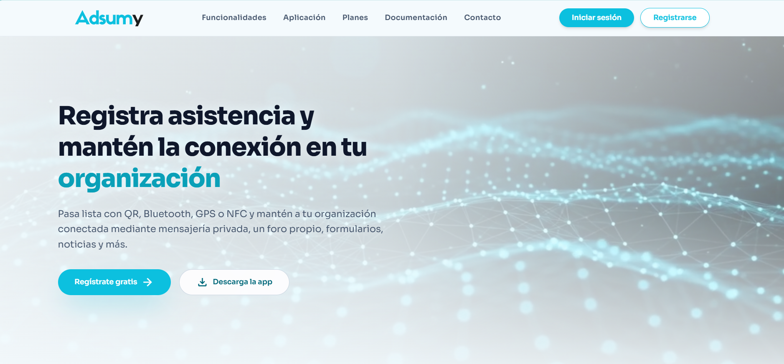
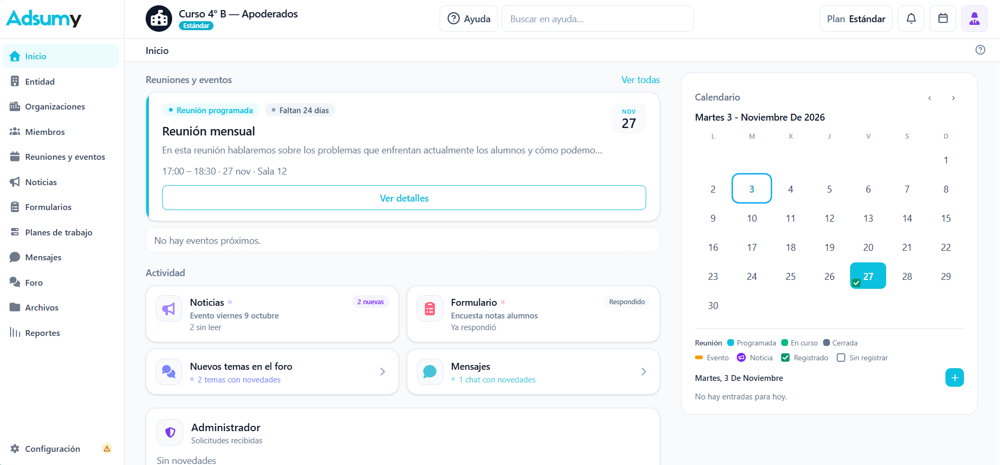
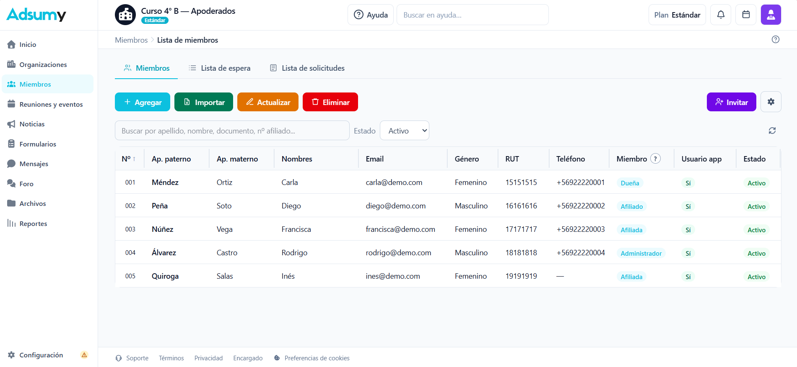
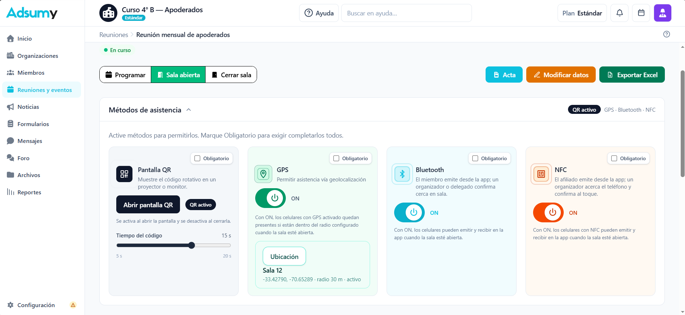
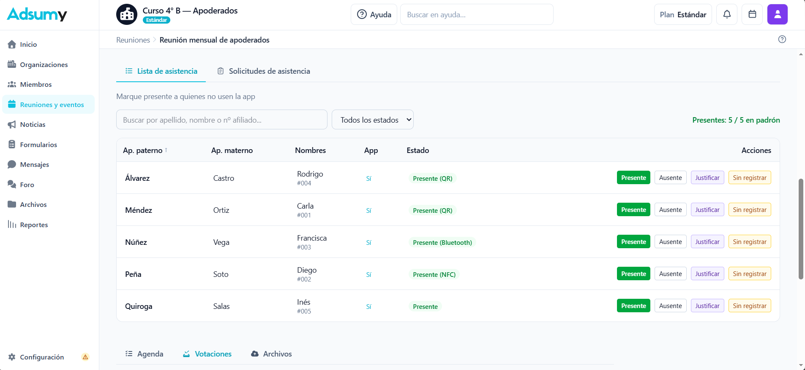
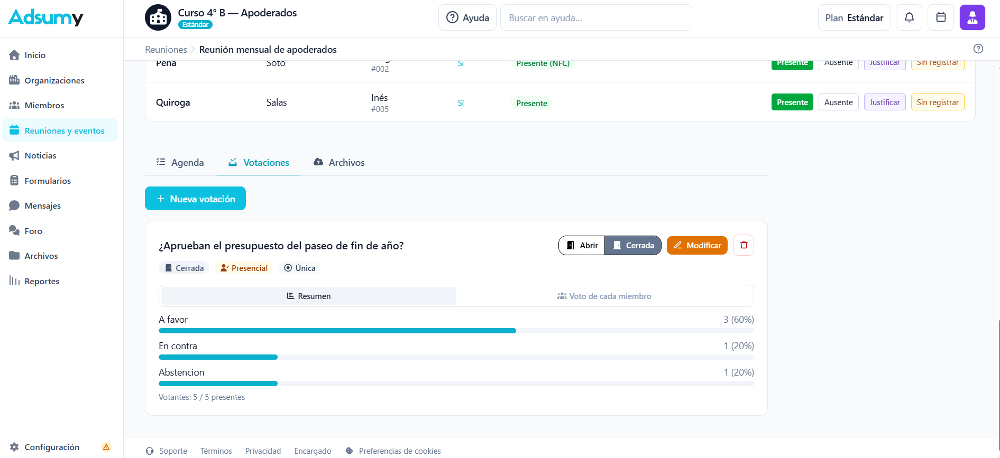
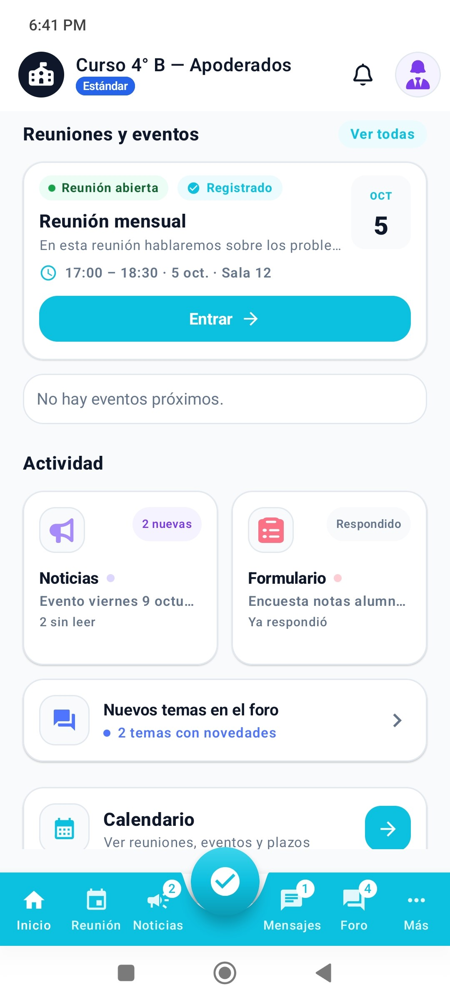
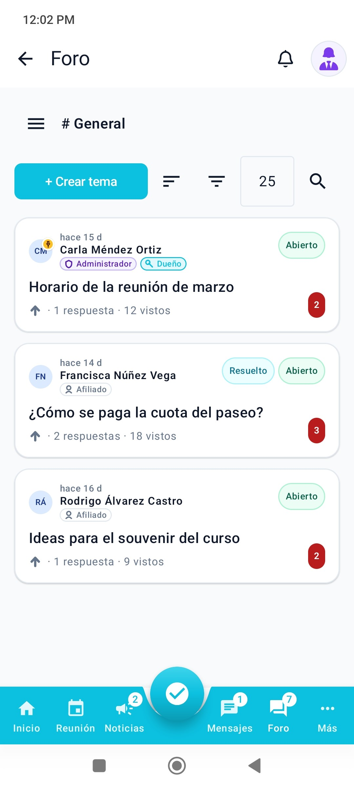
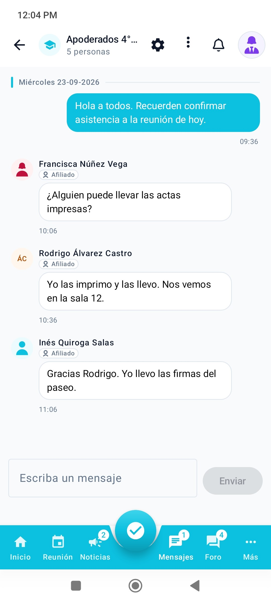

# Adsumy

Plataforma para sindicatos, juntas de vecinos, centros de padres, cursos y otras agrupaciones de personas. Concentra el padrón (miembros), la asistencia, las votaciones, la comunicación y los documentos de cada organización en un solo lugar, con roles y permisos separados por organización.

Sitio: [www.adsumy.com](https://www.adsumy.com)

Hay dos superficies que hablan con la misma API:

- **Panel web** para quien dirige la organización (dueño, administración y delegación).
- **App Android** (Kotlin y Jetpack Compose) para miembros: asistencia, noticias, votaciones, mensajes, foro y formularios.


---

## Stack

| Capa | Tecnología |
|------|------------|
| Panel y API | Next.js 15, React 19, TypeScript, Tailwind CSS 4 |
| Sesión web | Auth.js (cookies `httpOnly`) |
| App móvil | JWT propio contra la misma API |
| Base de datos | PostgreSQL |
| Tiempo real | Server-Sent Events (asistencia y votaciones abiertas, sin sondeo periódico) |
| Android | Kotlin, Jetpack Compose, minSdk 26 |
| Exportaciones | Excel (ExcelJS) y PDF |
| Mapas | Leaflet, solo para elegir el lugar de una reunión |
| Entorno local | Docker Compose para Postgres, o Postgres instalado en Windows |

El panel se despliega en **Render** (directorio `web`: build y start de Next.js). Cada ambiente (local, desarrollo, acceso anticipado y producción) tiene su propia base.

---

## Funcionalidades

### Asistencia

La asistencia vive dentro de una reunión abierta. Quien dirige elige uno o varios métodos a la vez: código QR, cercanía por GPS, Bluetooth o NFC. Con GPS solo se guarda si la persona estaba cerca del lugar; no se almacena el recorrido. El QR también puede abrirse como enlace web. El panel de la sala se actualiza en tiempo real mientras está abierta. Quien administra ve el listado; el miembro ve su propio estado y los totales.

### Miembros y altas

Cada organización tiene su padrón. Las personas entran por invitación por correo (funcionalidad extra activable), por código de unión o por una solicitud si la organización está visible en el buscador. El código y las solicitudes abiertas pasan por lista de espera: al aprobar, la cuenta se vincula a la ficha existente por correo, sin duplicar personas. El documento de identidad (en Chile, el RUT) no es obligatorio al crear la organización; el dueño puede exigirlo.

Roles: dueño, administración, delegación y miembro. La delegación no ve el padrón completo. Una cuenta puede pertenecer a varias organizaciones. El plan gratuito permite ser dueño de una; los planes de pago permiten varias, y con dos o más se pueden agrupar en una entidad.

### Reuniones, calendario y votaciones

Reuniones, eventos y noticias con fecha aparecen en el calendario. Al abrir la sala se habilitan la agenda, el acta, los archivos (si el plan lo permite) y las votaciones. Una votación puede ser presencial (solo quien ya marcó asistencia) o en línea (cualquier miembro activo con cuenta). Las opciones pueden ser fijas o libres, de selección única o múltiple, y el voto puede ser nominativo o secreto. Mientras está abierta, quien vota no ve el resultado.

### Comunicación y documentos

- **Mensajes:** chats privados y grupos solo entre miembros con cuenta de la misma organización. El texto del mensaje no viaja en la notificación push.
- **Foro:** canales, respuestas, menciones, temas fijados o resueltos, y adjuntos según el plan.
- **Noticias** y **notificaciones** dentro de la app, por correo y por push (Firebase Cloud Messaging en Android y en el navegador).
- **Formularios** privados (un envío por cuenta, editable mientras esté abierto) o públicos por enlace. Preguntas de texto, número, opciones, escala, imagen y fechas. Resumen, participación y exportación a Excel.
- **Planes de trabajo** con etapas, tareas y participantes.
- **Archivos** de la organización con permisos por rol. Estatutos, actas y adjuntos del foro comparten el cupo del plan.
- **Reportes** para el equipo que administra.

### Cuenta y cobro

Registro con verificación de correo, recuperación de contraseña y verificación en dos pasos. El dueño contrata un plan mensual en pesos chilenos. En producción el cobro es con **Transbank Oneclick** (inscripción de tarjeta y cargo recurrente). El plan gratuito muestra publicidad (AdSense en la web, AdMob en Android) solo después del consentimiento.

| Plan | Miembros activos | Almacenamiento de la organización |
|------|------------------|-----------------------------------|
| Gratis | hasta 5 | sin subida de archivos ni imágenes |
| Estándar | hasta 50 | 50 MB |
| Plus | hasta 100 | 100 MB |
| Pro | hasta 200 | 150 MB |
| A medida | según acuerdo | desde 400 MB |

---

## Sistemas conectados

```text
  Navegador          App Android           App iPhone
       |                  |                  |
       |                  |                  |
         +-------- API Next.js (Render) -----+
                         |
         +---------------+---------------+
         |               |               |
    PostgreSQL     Cloudflare R2     correo y push
                         |
              Cloudflare Workers
              (keep-alive y vencimientos)
```

| Sistema | Para qué se usa |
|---------|-----------------|
| **Render** | Aloja el panel, la API y PostgreSQL. Un servicio de desarrollo y otro público. |
| **Cloudflare (DNS y proxy)** | Dominio `adsumy.com`. El apex redirige a `www`. |
| **Cloudflare Turnstile** | Antibot en inicio de sesión, registro, recuperación de contraseña, formularios públicos, contacto y solicitud de eliminación de cuenta. No recibe el padrón ni la contraseña. |
| **Cloudflare R2** | Archivos e imágenes de la organización cuando el almacenamiento no está en el disco del servidor. Los objetos se sirven solo con sesión, a través de la API. |
| **Cloudflare Workers** | Dispara el cierre de períodos vencidos (archivo de organizaciones o cobro). El Worker solo llama a la API; no lee la base ni el padrón. |
| **Cloudflare Email Obfuscation** | Ofusca correos en el HTML público. Las direcciones legales van marcadas para seguir siendo legibles. |
| **Resend** | Correos de producto: activación de cuenta, invitaciones, restablecer contraseña y avisos. El cuerpo no incluye RUT ni el padrón. |
| **Firebase Cloud Messaging** | Push a Android y al navegador. El texto es genérico («Tienes un mensaje», «Tienes un aviso»). |
| **Transbank Oneclick** | Inscripción de tarjeta y cobro del plan en producción. Transbank no recibe el padrón. |
| **Google AdSense y AdMob** | Publicidad del plan gratuito, después del consentimiento. |

Los datos de una organización no se usan para otra, ni para entrenar modelos. En Chile el tratamiento se adecua a la Ley 21.719: el titular puede consultar, rectificar y pedir la eliminación de su cuenta. Borrar la cuenta no es lo mismo que borrar una ficha del padrón; cada organización administra la suya.

---

## Demostración visual

Capturas en [`media/`](./media/).

### Panel web

##### Landing 
<p align="center">
  
</p>

##### Inicio
<p align="center">
  
</p>

##### Miembros
<p align="center">
  
</p>

##### Asistencia
<p align="center">
  
</p>
<p align="center">
  
</p>

##### Votación
<p align="center">
  
</p>


### App Android
##### Inicio
<p align="center">
  

##### Foro
  <p align="center">
  
</p>

##### Mensajes
<p align="center">
  
</p>
</p>
